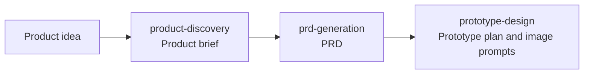

# 🍊 YouAI Skills

**Turn a product idea into a brief, a PRD, and a prototype plan before writing code.**

An open-source AI skill workflow for indie developers, side-project builders, and hackathon teams. Use it with Codex, Claude Code, Cursor, or Windsurf, or paste a full skill definition into an AI conversation.

[中文](./README.md) · [Try the workflow](./examples/teamlog-walkthrough_en.md) · [Installation guide (Chinese)](./docs/usage-guide.md) · [All skills](#all-skills)

[](./LICENSE)
[](./CONTRIBUTING.md)

## Start with an idea

> “I want to build a daily-report assistant that helps a technical lead understand team progress.”

| Step | What the skill helps you define | TeamLog sample (Chinese) |
|---|---|---|
| Product discovery | Users, pain points, MVP scope, and where to find initial users | [Product brief](./examples/example-product-discovery.md) |
| PRD generation | Features, acceptance criteria, data models, APIs, and page mapping | [PRD excerpt](./examples/example-prd-generation.md) |
| Prototype design | Pages, key states, wireframes, a shared visual style, and image prompts | [Prototype plan excerpt](./examples/example-prototype-design.md) |



TeamLog is fictional. These are manually written, abbreviated samples of deliverable structure, rather than a customer case or measured result. [Follow the walkthrough to run your own version →](./examples/teamlog-walkthrough_en.md)

## Your first run

**Try product discovery without installing anything:** Open the [full product-discovery definition (Chinese)](./skills/02_product-discovery.md), paste the entire file into a new AI conversation, then send:

```text
I want to build a daily-report assistant for a small technical team.
Use Express mode to clarify the target users, pain points, and MVP scope.
Start with a web app and exclude automatic Git integration from V1.
Mark uncertain assumptions as unverified. Please respond in English.
```

Answer the follow-up questions and confirm the scope to get a draft product brief. Pass the resulting document to the PRD and prototype skills. In a text-only chat, paste its contents instead. [Full steps and review checkpoints →](./examples/teamlog-walkthrough_en.md)

**Codex users can install the complete plugin:** Add the following repository as a plugin marketplace, set the Git ref to `main`, and leave the sparse path empty. Install `youai-skills` and start a new session.

```text
https://github.com/tardis9527/youai-skills.git
```

Then send:

```text
$product-discovery Help me define the MVP for a team daily-report assistant.
Use Express mode and respond in English.
```

For other tools, CLI commands, or installation into a project directory, see the [installation and usage guide (Chinese)](./docs/usage-guide.md).

## Requirements and scope

- The skills are free under the MIT license. AI subscriptions, model APIs, and image services have their own pricing.
- The core workflow can produce documents, wireframes, and image prompts. Generating actual images is optional and requires a configured image service.
- Skill definitions and most samples are currently in Chinese. This README and the [English walkthrough](./examples/teamlog-walkthrough_en.md) explain the workflow; full English skill translations are not yet available. Asking for English output does not replace a translated definition.
- An AI IDE can read and save files. In a text-only chat, supply reference material and save the results manually. Web research depends on the tools available in your AI environment.
- Outputs are drafts for review. Verify market data, technical decisions, permissions, and acceptance criteria, and retain unresolved questions in the document.

## All skills

The twelve skills work independently or use previous documents as input. Start with the three core skills above.

| Skill | Use case | Main output |
|---|---|---|
| [product-discovery](./skills/02_product-discovery.md) | Define a product and its MVP | Product brief, assumptions, and validation plan |
| [prd-generation](./skills/04_prd-generation.md) | Turn a brief or implementation plan into development specifications | PRD, acceptance criteria, and traceability matrix |
| [prototype-design](./skills/07_prototype-design.md) | Translate requirements into pages and interactions | Wireframes, design specifications, bilingual image prompts; optional image generation |
| [project-analysis](./skills/01_project-analysis.md) | Understand an existing codebase and business domain | Project analysis report |
| [market-research](./skills/03_market-research.md) | Evaluate a direction, competitors, and market risks | Research report with confidence annotations |
| [uiux-redesign](./skills/05_uiux-redesign.md) | Improve an existing product's interface and experience | Design system and implementation roadmap |
| [investor-bp-generation](./skills/06_investor-bp-generation.md) | Prepare fundraising and pitch materials | Markdown business plan / HTML presentation and oral pitch |
| [wechat-writer](./skills/08_wechat-writer.md) | Write WeChat articles and develop a personal voice | Article, image prompts, and local learning records |
| [moments-writer](./skills/09_moments-writer.md) | Write WeChat Moments captions | Caption candidates, image concepts, and local learning records |
| [imagegen-tardis](./skills/imagegen-tardis/SKILL.md) | Generate or edit images through a custom provider | Image files, previews, and download links |
| [comfyui-minimax-music](./skills/comfyui-minimax-music/SKILL.md) | Create songs or instrumental music in ComfyUI with MiniMax Music 3 | Work title, Caption, Lyrics, workflow and export settings, saved as a standard Markdown document |
| [mv-creator](./skills/mv-creator/SKILL.md) | Make an original song MV from scratch: write and sing the song → beat-based storyboard → keyframes → ComfyUI image-to-video | Original song, storyboard, characters and keyframes, video clips, CapCut asset pack and rough cut |

Other useful combinations:

- **Validate a direction:** Discovery → research → decision → PRD.
- **Take over a project:** Project analysis → PRD; add UI/UX redesign when needed.
- **Prepare a pitch:** Product brief + research / PRD → investor business plan.
- **Create content:** Use the writing skills independently and add image generation as needed.
- **Song MV:** mv-creator chains MiniMax music creation and Tardis image generation, then calls ComfyUI to generate video.

## Why use this workflow

- **Review checkpoints:** Define users and scope before expanding features and design. Discovery supports Express, Standard, and Deep modes.
- **Document handoffs:** Each step reads confirmed work to reduce repeated explanations of project context.
- **Quality checks:** PRD and prototype definitions require evidence, states, traceability, and self-review, with unknowns explicitly marked.
- **Editable and reusable:** Adapt the prompts, supporting files, and default technical choices to your project.

## Documentation and contributions

- [Sample index (Chinese)](./examples/README.md): Deliverable examples for individual skills.
- [Usage guide (Chinese)](./docs/usage-guide.md): Installation, workflows, and common questions.
- [Contributing (Chinese)](./CONTRIBUTING.md): Report issues, share actual runs, translate, or improve skills.
- [Distribution guide (Chinese)](./docs/distribution-guide.md): Positioning, sharing copy, and release preparation.

When reporting an issue, include the tool version, skill name, sanitized input, and actual result. Human edits are useful feedback too.

If this workflow helps you, **Star** the repository to save it and support the project.

## Repository maintenance

`skills/` is the source of truth. `plugins/youai-skills/skills/` is the generated Codex package containing both entry files and full definitions. After updating source skills, run:

```powershell
powershell -NoProfile -ExecutionPolicy Bypass -File scripts/sync-codex-plugin.ps1
powershell -NoProfile -ExecutionPolicy Bypass -File scripts/check-skill-sync.ps1
```

The plugin copy removes the unsupported `disable-model-invocation: true` field. Use `scripts/validate-product-artifact.ps1` for structural checks of PRD / prototype outputs; see the usage guide for parameters.

Licensed under [MIT](./LICENSE).
